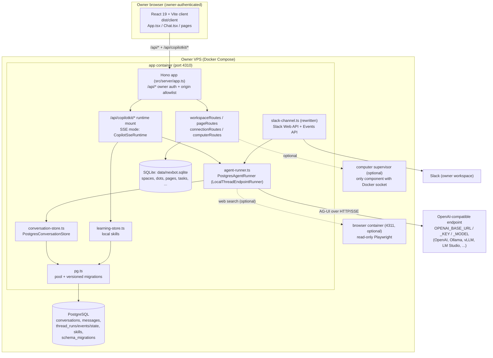
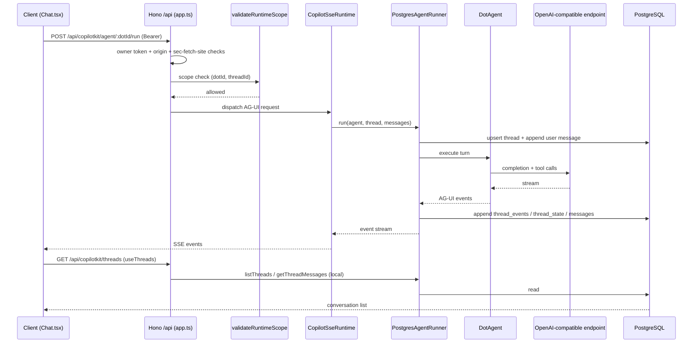

# Architecture

This is the load-bearing document for the fork. It describes the target
architecture after decoupling, the current upstream state it replaces, and the
precise seam points that make the replacement safe.

Status vocabulary: **DONE** (exists in this repo now), **PLANNED** (assigned to
a work order, designed here).

## 1. Component diagram



Everything inside `VPS` is owner-controlled. The only external endpoints are
the owner-selected model endpoint and the owner's Slack workspace; both are
optional except the model endpoint, which is required for agent runs.

## 2. Request flow for a chat turn

Current (upstream) and target (fork) flow for one user message in the UI:

1. **Client → server.** `src/client/Chat.tsx` sends the turn to
   `/api/copilotkit/agent/:dotId/run` with the `Authorization: Bearer
<OWNER_TOKEN>` header. `/api/copilotkit/*` requests are handled by
   `Platform.handle()` (`src/server/platform.ts`).
2. **Auth + scope.** `createApp` middleware (`src/server/app.ts`) validates
   owner token (timing-safe), `APP_ORIGIN`, and `sec-fetch-site`; then
   `validateRuntimeScope` (`src/server/runtime-scope.ts`) confirms the path
   addresses a Dot/thread the workspace actually owns.
3. **Runtime dispatch.** The CopilotKit Hono handler routes the AG-UI request.
   In the fork this is **SSE mode**: the runtime holds a `runner: AgentRunner`.
4. **Agent execution.** `PostgresAgentRunner` (`src/server/agent-runner.ts`)
   invokes `DotAgent` (`src/server/dot-agent.ts`), which calls the
   OpenAI-compatible endpoint and, as needed, tools (MCP connections, web
   search, computers, page tools).
5. **Persistence.** During and after the run, the runner writes the thread,
   messages, run record, streamed AG-UI events, and thread state through
   `PostgresConversationStore` into PostgreSQL via `src/server/pg.ts`.
6. **Streaming back.** AG-UI events stream back over SSE to the client, which
   renders via the unchanged client code.
7. **Conversation list.** On load, `useThreads()` calls the REST thread
   endpoints. In the fork these are served **locally** by the same runtime
   because the runner implements `LocalThreadEndpointRunner` (Section 4).

Server-side turns (voice compute, scheduled tasks) follow the same path but are
initiated in-process: `src/server/headless.ts` uses `HttpAgent` from
`@ag-ui/client` against our own `/api/copilotkit/run` with the owner bearer
header, instead of the hosted `IntelligenceAgent`.



## 3. Server module map

Current modules that the decoupling touches or depends on (real paths):

| Module                                                | Role                                                                                                           | Change                                                                                               |
| ----------------------------------------------------- | -------------------------------------------------------------------------------------------------------------- | ---------------------------------------------------------------------------------------------------- |
| `src/server/index.ts`                                 | Bootstrap: reads env, constructs `Store`, `WorkspaceStore`, `Platform`, `Runner`, `createApp`, starts `serve`. | Rewired to build Postgres pool + SSE runtime instead of Intelligence mode (WORK-004/008).            |
| `src/server/app.ts`                                   | Hono app, `/api/*` auth middleware, task/settings/memory routes, static client serving, CSP.                   | Reused; health/readiness endpoint added (WORK-008).                                                  |
| `src/server/platform.ts`                              | Owns `CopilotKitIntelligence`, `CopilotRuntime`, `createCopilotHonoHandler`, `PageService`, channels.          | Rewritten: SSE runtime + `PostgresAgentRunner`; Intelligence removed (WORK-004).                     |
| `src/server/platform-config.ts`                       | Env parsing, `setupStatus`, `INTELLIGENCE_KEY_MISSING_LABEL`.                                                  | Drop `intelligenceKey` requirement; keep model/browser/voice/composio/slack statuses (WORK-004/007). |
| `src/server/headless.ts`                              | Server-side/voice/scheduled turns via hosted `IntelligenceAgent`; `z.literal('intelligence')` gate.            | Replaced with `HttpAgent` against own endpoint; gate removed (WORK-004).                             |
| `src/server/page-service.ts`                          | `PageIntelligence` seam: `getOrCreateThread`, `getThreadMessages`.                                             | Satisfied by `PostgresConversationStore` (WORK-003).                                                 |
| `src/server/learning.ts`                              | `learningSelector` for hosted learning containers.                                                             | Replaced by local skills store (WORK-006).                                                           |
| `src/server/slack-channel.ts`                         | Managed `createChannel` + identity mapping.                                                                    | Rewritten for Slack Web API + Events API (WORK-005).                                                 |
| `src/server/setup-telemetry.ts`                       | Setup telemetry + CopilotKit telemetry identity.                                                               | Telemetry identity removed; local setup status kept (WORK-004).                                      |
| `src/server/runtime-scope.ts`                         | Path/method/ownership validation for `/api/copilotkit/*`.                                                      | Reused as-is; extended for any new local thread routes (WORK-004).                                   |
| `src/server/store.ts`                                 | `node:sqlite` `DatabaseSync`, WAL, tasks/runs/events/memories/settings/telemetry.                              | Unchanged (stays on SQLite).                                                                         |
| `src/server/workspace.ts`                             | Spaces, Dots, thread bindings, calls, captures, dot↔space.                                                     | Unchanged storage; thread _content_ moves to Postgres (WORK-003).                                    |
| `src/server/pages.ts`                                 | Pages, page revisions, `page_reviews`, `page_threads`.                                                         | Unchanged.                                                                                           |
| `src/server/connection-store.ts`, `connections.ts`    | MCP connections/approvals/actions.                                                                             | Unchanged.                                                                                           |
| `src/server/computer-store.ts`, `computer-service.ts` | Computer permissions/audit, supervisor client.                                                                 | Unchanged.                                                                                           |

New modules introduced by the fork:

| New module                                | Purpose                                                                                            | Work order |
| ----------------------------------------- | -------------------------------------------------------------------------------------------------- | ---------- |
| `src/server/pg.ts`                        | PostgreSQL connection pool + idempotent, versioned migrations (`schema_migrations`).               | WORK-003   |
| `src/server/conversation-store.ts`        | `PostgresConversationStore`: threads, messages, runs, events, state; satisfies `PageIntelligence`. | WORK-003   |
| `src/server/agent-runner.ts`              | `PostgresAgentRunner extends AgentRunner implements LocalThreadEndpointRunner`.                    | WORK-003   |
| `src/server/learning-store.ts`            | Local per-Dot skills, revisions, delivery flag.                                                    | WORK-006   |
| `src/server/slack-channel.ts` (rewritten) | Self-hosted Slack Events API + Web API.                                                            | WORK-005   |

## 4. The CopilotKit decoupling seam table

This is the authoritative mapping. Each upstream CopilotKit entry point and its
approved replacement:

| Upstream (hosted/proprietary)                                                                                                                                        | Replacement                                                                                                                                                                                                                                            | Why the replacement works                                                                                                                        |
| -------------------------------------------------------------------------------------------------------------------------------------------------------------------- | ------------------------------------------------------------------------------------------------------------------------------------------------------------------------------------------------------------------------------------------------------ | ------------------------------------------------------------------------------------------------------------------------------------------------ |
| `CopilotKitIntelligence` (`@copilotkit/runtime/v2`) — hosted thread store, memory, learning containers; requires `CPK_INTELLIGENCE_API_KEY` / `INTELLIGENCE_API_KEY` | `PostgresConversationStore` — self-hosted thread/message persistence in PostgreSQL. Satisfies the app's existing structural seam `PageIntelligence` in `src/server/page-service.ts` (methods `createThread`, `getOrCreateThread`, `getThreadMessages`) | The app already calls only those three methods through a narrow interface; the hosted client becomes a local store with identical method shapes. |
| `IntelligenceAgentRunner` (hosted realtime WS gateway, durable threads)                                                                                              | `PostgresAgentRunner extends AgentRunner implements LocalThreadEndpointRunner` — runs agents locally and persists threads/messages/events/state in PostgreSQL                                                                                          | `AgentRunner` is an abstract class; implementing it locally removes the hosted gateway.                                                          |
| `CopilotRuntime` in **Intelligence mode** (requires `intelligence:`)                                                                                                 | `CopilotRuntime` in **SSE mode** (`CopilotSseRuntime`): options take `runner?: AgentRunner`, and `intelligence?: undefined` / `channels?: undefined`. MIT, no API key                                                                                  | SSE mode is a first-class, MIT runtime mode; it needs a runner, which we provide.                                                                |
| `IntelligenceAgent` (`@copilotkit/core`) in `src/server/headless.ts` for server-side/voice/scheduled turns, connecting to `info.intelligence.wsUrl`                  | `HttpAgent` from `@ag-ui/client` (MIT v0.0.59) speaking the open AG-UI protocol to our own `/api/copilotkit/run`. The `z.literal('intelligence')` runtime-info schema gate is removed                                                                  | AG-UI is an open protocol; `HttpAgent` is a protocol client, not a host client.                                                                  |
| `@copilotkit/channels` `createChannel` (managed Slack; requires Intelligence mode)                                                                                   | A self-hosted Slack integration using the Slack Web API + Events API (signing-secret verified), registered as its own Hono routes, invoking the same local agent runner                                                                                | Slack's own APIs are public and owner-controllable; the managed channel is a convenience wrapper requiring Intelligence.                         |
| Hosted learning containers / `getLearnedSkillsSnapshots` / `learnedSkills: { containers, apiKey, apiUrl }`                                                           | Local skills store in PostgreSQL (per-Dot skills, revisions, delivery enabled/disabled)                                                                                                                                                                | Skills are per-Dot data the owner can store and serve locally.                                                                                   |
| CopilotKit telemetry ingest `https://telemetry.copilotkit.ai/ingest`, `CPK_TELEMETRY_ID`, `COPILOTKIT_TELEMETRY_*`                                                   | **Removed.** No outbound call to any CopilotKit host                                                                                                                                                                                                   | Removing the client removes the calls; nothing depends on it functionally.                                                                       |

**Retained:** `@copilotkit/runtime` and `@copilotkit/react-core` (both MIT,
v1.75.0) remain as local-only libraries. They require no account, no key, and
make no call to a CopilotKit host. Deliberate, recorded decision (ADR-0002).

## 5. Why SSE mode + `LocalThreadEndpointRunner` is sufficient

This is the key feasibility argument, backed by specific evidence in the
installed packages.

1. **SSE mode is a supported runtime mode.** In `@copilotkit/runtime@1.75.0`,
   `dist/v2/runtime/core/runtime.d.mts` declares:

   ```ts
   CopilotSseRuntimeOptions extends BaseCopilotRuntimeOptions {
     runner?: AgentRunner;
     intelligence?: undefined;
     generateThreadNames?: undefined;
     channels?: undefined;
   }
   ```

   So a runtime can be constructed with only a `runner`, with `intelligence`
   and `channels` explicitly absent. This mode is MIT and needs no API key.

2. **A runner contract exists and is implementable locally.** `AgentRunner` is
   an abstract class with `run`, `connect`, `isRunning`, and `stop`.
   `LocalThreadEndpointRunner` adds `listThreads`, `getThreadMessages`,
   `getThreadEvents`, `getThreadState`, `clearThreads`, plus the marker
   `ɵsupportsLocalThreadEndpoints: true`, which the type guard
   `supportsLocalThreadEndpoints(runner)` checks.

3. **The server already treats a local thread backend as first class.**
   `dist/v2/runtime/handlers/get-runtime-info.mjs:128`:

   ```js
   const hasRestThreadBackend =
     isIntelligenceRuntime(runtime) ||
     supportsLocalThreadEndpoints(runtime.runner);
   ```

   A runner implementing the local marker makes the runtime report a REST thread
   backend.

4. **The thread handlers delegate to the local runner.** In
   `dist/v2/runtime/handlers/intelligence/threads.mjs` (lines 63, 84, 191, 240, 269) the handlers fall back to `runtime.runner` when
   `supportsLocalThreadEndpoints(runtime.runner)` is true.

5. **Consequence: the client needs no rewrite.** The REST thread endpoints that
   the client's `useThreads()` calls are served locally by our runner. The
   965-line `src/client/App.tsx` and 489-line `src/client/Chat.tsx` continue to
   work unmodified.

## 6. Source hierarchy

```
src/
  server/     Hono API, stores, runtime wiring, agents, services   (compiled by tsc)
  browser/    isolated Playwright service (own Hono app, /health, /browse)
  shared/     zod schemas and types shared by server + client
  client/     React 19 + Vite UI (built to dist/client)
  build/      build-time helpers (e.g. dark-theme)
tests/        Vitest suites (56 files at baseline)
docs/fork/    this documentation set
docs/         upstream docs (SETUP.md, COMPUTERS.md, ...; unchanged)
```

Entrypoints: `src/server/index.ts` (app) and `src/browser/index.ts` (browser
service). Shared schemas in `src/shared/` are the contract between the Hono
routes and the React client.

## 7. Build output layout

`npm run build` = `vite build && tsc -p tsconfig.server.json`:

```
dist/
  client/                 Vite build of the React client (served by serveStatic)
  server/
    server/               compiled src/server/**  (entry: server/index.js)
    browser/              compiled src/browser/** (entry: browser/index.js)
    shared/               compiled src/shared/**
```

`tsconfig.server.json` extends `tsconfig.json` with
`module`/`moduleResolution: NodeNext`, `outDir: dist/server`, `rootDir: src`,
and `include: ["src/server", "src/browser", "src/shared"]`.

Docker images (see `Dockerfile`): a `build` stage runs `npm run build`; the
`app` stage copies `dist/` and runs `node dist/server/server/index.js` on port
`4310`; the `browser` stage runs `node dist/server/browser/index.js` on port
`4311`, with Playwright chromium installed.

Ports: app `4310`; browser service `4311`; computer supervisor `4312` → `4300`;
dev Vite `5173` proxying `/api` to `127.0.0.1:4310`.
